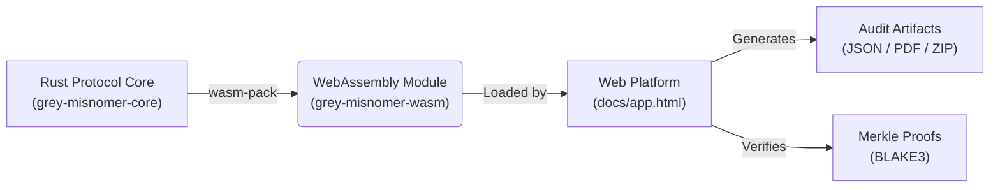

<div align="center">
  
  <h1>GreyMisnomer</h1>
  <p><strong>A zero-trust, immutably-auditable carbon credit registry running entirely in the browser.</strong></p>

  [](LICENSE)
  []()
  [](https://www.rust-lang.org/)
  [](https://webassembly.org/)
  [](https://greymisnomer.github.io/GreyMisnomer/)
  [](https://github.com/GreyMisnomer/GreyMisnomer/actions/workflows/pages.yml)
</div>

---

Like Bitcoin Core, but for carbon credits. GreyMisnomer solves the opacity and double-counting issues in voluntary carbon markets by moving the core registry logic — including Merkle proofs, invariants, and credit batching — into a cryptographically verifiable WebAssembly module.

**Not a marketplace. A settlement layer.**

---

## 🚀 Try it Live

> **[Open the Interactive Platform →](https://greymisnomer.github.io/GreyMisnomer/)**

The entire 7-step protocol (MRV data upload → Merkle Commitment → Verification → Minting → Transfer → Retirement → Audit Export) is available to test directly in your browser. **No backend, no database, no setup required.**

---

## 📑 Table of Contents

- [Vision](#-vision)
- [Architecture](#-architecture)
- [Invariants Enforced](#-invariants-enforced)
- [Project Structure](#-project-structure)
- [Getting Started](#-getting-started)
- [Testing](#-testing)
- [RFCs & Specifications](#-rfcs--specifications)
- [Documentation & Links](#-documentation--links)
- [Tech Stack](#-tech-stack)
- [Contributing](#-contributing)
- [License](#-license)

---

## ⚡ Vision

Build **registry-first infrastructure** for carbon markets where:

| Principle | Description |
|-----------|-------------|
| **Registry > Market** | Separation of credit legitimacy from price discovery |
| **Proof-of-Integrity (PoI)** | Cryptographic proof must exist before minting |
| **Proof-of-Offset (PoO)** | Irreversible consumption receipt for retired credits |
| **Serialization** | Every single credit is uniquely tracked end-to-end |

---

## 🏗 Architecture

GreyMisnomer moves the state machine out of a trusted backend and into the client browser:



| Layer | Crate / Path | Purpose |
|-------|-------------|---------|
| **Core Protocol** | `src/core/` | RFC invariants, BLAKE3 Merkle trees, supply arithmetic |
| **WASM Bindings** | `src/wasm/` | Exposes the Rust state machine to JavaScript via `wasm-bindgen` |
| **CLI** | `src/cli/` | Command-line interface for headless protocol interaction |
| **Web Platform** | `docs/` | 100% client-side SPA with role-based access control |

---

## 🔒 Invariants Enforced

The WASM core mathematically prevents:

- **Replay attacks** — A Proof-of-Integrity (PoI) can only be minted into credits exactly once.
- **Supply inflation** — Minted amounts must exactly match the length of the serial number range.
- **Double spending** — Credit transfers and retirements track precise serial slices; overlapping ranges are rejected.
- **Tampering** — All MRV sensor data is committed to a BLAKE3 Merkle tree before minting can occur.

---

## 📁 Project Structure

```
GreyMisnomer/
├── .devcontainer/              # Dev container config (Codespaces-ready)
├── .github/
│   └── workflows/
│       └── pages.yml           # CI: Build WASM + Deploy to GitHub Pages
├── architecture/               # System design documents & diagrams
│   ├── diagrams/               # High-level architecture & sequence diagrams
│   ├── design_document_v2.pdf  # Whitepaper
│   └── qna_document_v1.pdf    # Q&A document
├── docs/                       # GitHub Pages root (deployed site)
│   ├── css/                    # Stylesheets (landing + platform)
│   ├── js/                     # Platform application logic (app.js)
│   ├── pkg/                    # Compiled WASM output (auto-generated)
│   ├── rfc/                    # RFC specification documents
│   ├── GreyMisnomer_Logos/     # Branding assets (multiple sizes)
│   ├── index.html              # Landing page
│   ├── app.html                # Platform SPA
│   └── DEVELOPMENT_SETUP.md   # Developer setup guide
├── research/                   # Academic papers & references
│   └── papers/
├── src/                        # Rust source code
│   ├── core/                   # grey-misnomer-core (protocol library)
│   │   ├── src/
│   │   │   ├── lib.rs          # Library entry point
│   │   │   ├── registry.rs     # Central registry state machine
│   │   │   ├── project.rs      # Project registration
│   │   │   ├── credit.rs       # Credit batch & supply logic
│   │   │   ├── poi.rs          # Proof-of-Integrity
│   │   │   ├── poo.rs          # Proof-of-Offset (retirement)
│   │   │   ├── serial.rs       # Serial number range tracking
│   │   │   ├── error.rs        # Custom error types
│   │   │   └── mrv/            # MRV data & Merkle tree module
│   │   ├── tests/              # Integration tests
│   │   └── examples/           # Demo example (demo.rs)
│   ├── wasm/                   # grey-misnomer-wasm (JS bindings)
│   │   └── src/lib.rs          # wasm-bindgen entry point
│   └── cli/                    # grey-misnomer-cli (command-line tool)
│       └── src/main.rs
├── test/                       # E2E & automation testing
│   ├── e2e/                    # Playwright E2E test specs
│   ├── GreyMisnomer_TestCases.xlsx  # Comprehensive test matrix
│   └── playwright.config.js   # Playwright configuration
├── .gitignore
├── Cargo.toml                  # Rust workspace definition
├── Cargo.lock                  # Locked dependency versions
├── CODE_OF_CONDUCT.md
├── CONTRIBUTING.md
├── LICENSE                     # MIT License
└── README.md                   # You are here
```

---

## 🚀 Getting Started

### Prerequisites

| Tool | Install |
|------|---------|
| **Rust** (stable) | `rustup default stable` |
| **wasm32 target** | `rustup target add wasm32-unknown-unknown` |
| **wasm-pack** | `cargo install wasm-pack` or [wasm-pack.rustwasm.org](https://rustwasm.github.io/wasm-pack/installer/) |
| **Node.js** (LTS) | [nodejs.org](https://nodejs.org/) |

### 1. Clone the repository

```bash
git clone https://github.com/GreyMisnomer/GreyMisnomer.git
cd GreyMisnomer
```

### 2. Build the WASM module

```bash
cd src/wasm
wasm-pack build --target web --out-dir ../../docs/pkg --out-name grey_misnomer_wasm
```

### 3. Run the Rust tests

```bash
cd ../../
cargo test --workspace
```

### 4. Serve the web platform locally

```bash
cd docs
npx -y http-server -p 8080 --cors -c-1
```

Open [http://localhost:8080/app.html](http://localhost:8080/app.html) in your browser.

> **Tip:** You can also use the [Dev Container](.devcontainer/devcontainer.json) for a pre-configured Codespaces environment.

### 5. Verify the Public Event Log & Bitcoin Proof Locally

```bash
# Verify the entire event log using the Rust CLI replayer
cargo run -p grey-misnomer-cli -- docs/events.jsonl

# Output machine-readable JSON verification summary
cargo run -p grey-misnomer-cli -- docs/events.jsonl --json

# Verify the OpenTimestamps Bitcoin anchoring proof (requires `pip install opentimestamps-client`)
ots verify docs/events.jsonl.ots
```

Or open [http://localhost:8080/app.html](http://localhost:8080/app.html) (or the [Live Platform](https://greymisnomer.github.io/GreyMisnomer/)), navigate to the **Audit** tab, and your browser will independently replay `events.jsonl` in client-side WebAssembly, validate the SHA-256 hash chain, check all 7 protocol invariants, and inspect the Bitcoin attestation proof.

---

## 🧪 Testing

### Rust Unit & Integration Tests

```bash
cargo test --workspace
```

### E2E Browser Tests (Playwright)

```bash
cd test
npm install
npx playwright install chromium
npm run test
```

### Test Matrix

A comprehensive test matrix with 30+ test cases covering RBAC, WASM invariants, MRV, cryptography, marketplace, and edge cases is maintained in [`test/GreyMisnomer_TestCases.xlsx`](test/GreyMisnomer_TestCases.xlsx).

---

## 📜 RFCs & Specifications

All protocol behavior is specified through RFCs before implementation:

| RFC | Title | Status |
|-----|-------|--------|
| [RFC-001](docs/rfc/rfc-001.md) | Two-Proof Model (PoI / PoO) | ✅ Implemented |
| [RFC-002](docs/rfc/rfc-002.md) | Credit Serialization Format & Range Locking | ✅ Implemented |
| [RFC-003](docs/rfc/rfc-003.md) | MRV Data Commitment & Merkle Root Format | ✅ Implemented |
| [RFC-004](docs/rfc/rfc-004.md) | Canonical Event Log Schema & Hash Chain Replayer | ✅ Implemented |
| [RFC-005](docs/rfc/rfc-005.md) | Cryptographic Identity & Signed Events Specification | 📋 Proposed (Stage 1.5) |

> New features require an accepted RFC before code is written. See the [RFC template](docs/rfc/rfc-template.md) to propose a new specification.

---

## 📚 Documentation & Links

| Resource | Link |
|----------|------|
| **Live Platform** | [greymisnomer.github.io/GreyMisnomer](https://greymisnomer.github.io/GreyMisnomer/) |
| **Whitepaper** | [Design Document v2](architecture/design_document_v2.pdf) |
| **Q&A Document** | [Questions & Answers](architecture/qna_document_v1.pdf) |
| **Architecture Diagrams** | [architecture/diagrams/](architecture/diagrams/) |
| **Development Setup** | [docs/DEVELOPMENT_SETUP.md](docs/DEVELOPMENT_SETUP.md) |
| **Discord** | [discord.gg/CZXXPJUNM](https://discord.gg/CZXXPJUNM) |
| **Reddit** | [r/GreyMisnomer](https://reddit.com/r/GreyMisnomer) |

---

## 🛠 Tech Stack

| Category | Technology |
|----------|-----------|
| **Core Protocol** | Rust (2021 Edition) |
| **Cryptography** | BLAKE3 (Merkle Trees) |
| **Web Runtime** | WebAssembly via `wasm-pack` + `wasm-bindgen` |
| **Client Application** | Vanilla JavaScript, HTML5, CSS3 |
| **CI/CD** | GitHub Actions → GitHub Pages |
| **E2E Testing** | Playwright |
| **Dev Environment** | VS Code Dev Containers / GitHub Codespaces |

---

## 🤝 Contributing

We welcome contributions! Please read:

1. **[CONTRIBUTING.md](CONTRIBUTING.md)** — Development workflow, PR guidelines, and philosophy.
2. **[CODE_OF_CONDUCT.md](CODE_OF_CONDUCT.md)** — Community standards.

**Contribution Philosophy:**

- **Design > Code** — No PRs without an accepted RFC.
- **Registry rules are conservative** — Changes to core invariants require immense scrutiny.
- **Backward compatibility is sacred** — We cannot invalidate existing credits.
- **Security > Performance > UX** — The registry must be bulletproof above all else.

---

## 📄 License

This project is licensed under the [MIT License](LICENSE) — open, permissive, and production-ready.

---

<div align="center">
  <sub>Built for climate integrity 🌍</sub>
</div>